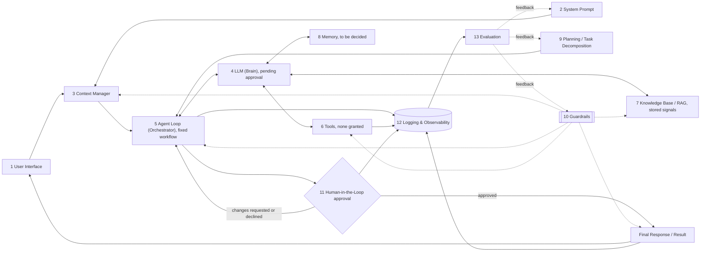

# Social Signal Discovery: agent architecture

How the 13 core agent components would work together for Social Signal Discovery. **This is a
design. No component in it has been built for this agent**, apart from the existing platform
pieces named in "What exists today" below.

## 1. The job, and the class of agent

**The capability's business outcome** (platform capability record, quoted in the L1 story):
"A continuously refreshed, de-duplicated pool of public posts and threads where an enterprise
AI-leadership buyer is visibly asking the question Colaberry answers, so outreach starts from a
real conversation instead of a cold list."

**The first agent behavior** the platform defines for it (release behavior at `autonomy:R2`):
"Answers 'where are buyers talking about this' from already-stored signals without scanning."
Its acceptance: "Every answer cites a stored openclaw_signals row id; zero outbound network calls
in the trace."

**The class of agent: a tool-using agent, inside fixed workflows.** This follows the
recommendation in [../../discovery/01-system-classes.md](../../discovery/01-system-classes.md):
fixed workflows stay the execution layer, the agent uses a small set of granted tools, and every
outbound step keeps its human gate. This design does not propose a free-form or multi-agent system.

**The first version is read-only.** It follows the R2 direction proposed in
[../../discovery/social-signal-discovery-audit.md](../../discovery/social-signal-discovery-audit.md)
(section "Proposed R2 architecture"): a separate path that answers from stored signals only, cites
row ids, makes no outbound calls and never scans, inserts or modifies. **Sohail has not approved
that proposal.**

## 2. Architecture diagram

How to read it:

- **Solid arrows** are the path of one request. **Dotted arrows from Guardrails** show that
  guardrails act at every stage, not only on the final answer: on what enters the context, on what
  the orchestrator may do next, on every tool call, on what may be retrieved, and on the result.
- **Human-in-the-Loop** sits before any result takes effect. A declined or changed run goes back
  to the orchestrator; nothing bypasses the approval.
- **Logging** records every step, and **Evaluation** feeds findings back into the system prompt,
  the workflow and the guardrails. Nothing in the feedback loop changes autonomy or permissions;
  those change only by a named human's decision.
- **The LLM node is pending approval.** A call to a hosted model is an outbound network call, which
  the R2 acceptance forbids. The first version is designed to run without one (see section 4).

## 3. One request, end to end (proposed)

1. A marketing user asks a question in the **User Interface**, for example "where are buyers talking
   about AI training this month?"
2. The **Context Manager** builds the working context: the question, any filters (platform, date
   range), the **System Prompt** rules, and limits from the **Guardrails** (read-only, cite every
   statement, bounded result size).
3. The **Agent Loop** runs a fixed workflow chosen by **Planning**: retrieve, check, compose,
   submit for approval. It does not improvise new steps.
4. The **Knowledge Base / RAG** step retrieves matching rows from stored signals only, using a
   deterministic match on stored fields (title, excerpt, topic tags, platform, date). Retrieval runs
   through a granted read **Tool** only; today no tool is granted.
5. The answer is composed from the retrieved rows, each statement carrying the row id it rests on.
   With no LLM approved, composition is a fixed template (counts by platform plus the matching rows).
6. **Guardrails** check the draft: every statement cited, no outbound call attempted, nothing
   written, no excluded platform present.
7. **Human-in-the-Loop:** a named human approves the run before it takes effect, as the L4 story
   requires ("Every run in the evidence window was approved by a named human before it took
   effect, and the record shows who").
8. **Logging & Observability** records the run: inputs, rows read, citations, guardrail results,
   approver, and the count of outbound attempts (expected 0).
9. **Evaluation** compares runs with the L1 run log and the R2 test assertions, and feeds back.

## 4. What exists today, and what is proposed

| Area | Exists today (verified where cited) | Proposed by this design |
|---|---|---|
| Signal collection | The platform scanner, `openclawMarketSignalAgent.ts`, which calls public platform APIs live and writes `openclaw_signals` rows (audit, question 1) | Not used by the first version. The R2 path never calls it |
| Stored signals | The `openclaw_signals` table and model (audit, questions 3 and 7) | Read-only, deterministic retrieval over it |
| A user interface | The Command Center (`index.html`), read-only, verified with `marketing.STORY-000`. Platform admin pages are listed for this capability (`/admin/intelligence`, Outreach tab), not yet checked by us | A question box for this capability; its location is to be decided |
| An agent run wrapper | The platform's `runAgent` wrapper, which also writes an activity log row on scheduled runs (audit, question 11) | Whether R2 runs go through it is a decision for Sohail (audit, "Design constraints") |
| Governance | The autonomy ladder, `effectiveAuthority()`, `no_tool_grants`, human-decision caps ([human-approval-boundaries.md](../../capabilities-map/human-approval-boundaries.md)) | Per-run human approval and the guardrail checks above |
| Agent identity | An agent record, disabled, `observe`, no tools; no system prompt or charter ([../../discovery/02-agent-anatomy.md](../../discovery/02-agent-anatomy.md)) | A system prompt and charter, written after L1 and L2 |
| Evaluation | None for this capability | The L1 run log as reference outcome, plus the R2 test design (audit, "Proposed validation test") |

Component-by-component detail: [02-component-implementation-matrix.md](02-component-implementation-matrix.md).

## 5. Known data cautions for the knowledge layer

From the November 9, 2026 read-only review of the signal data model (platform code, not
production data):

- The `openclaw_signals` table also holds rows that are **not buyer conversations**: Colaberry's
  own generated LinkedIn posts, comment-reply batches and internal post-tracking rows. Retrieval
  must filter to rows the scanner wrote, or an answer could cite Colaberry's own posts as "buyers
  talking".
- `relevance_score` is set to fixed values by several writers, so it is not a reliable ranking.
- There is no text or topic index; a topic search reads the whole table.
- The original post date is stored inside `details`, under a different key per platform.

These shape the retrieval design and are open items in
[04-l1-l2-validation-plan.md](04-l1-l2-validation-plan.md).
