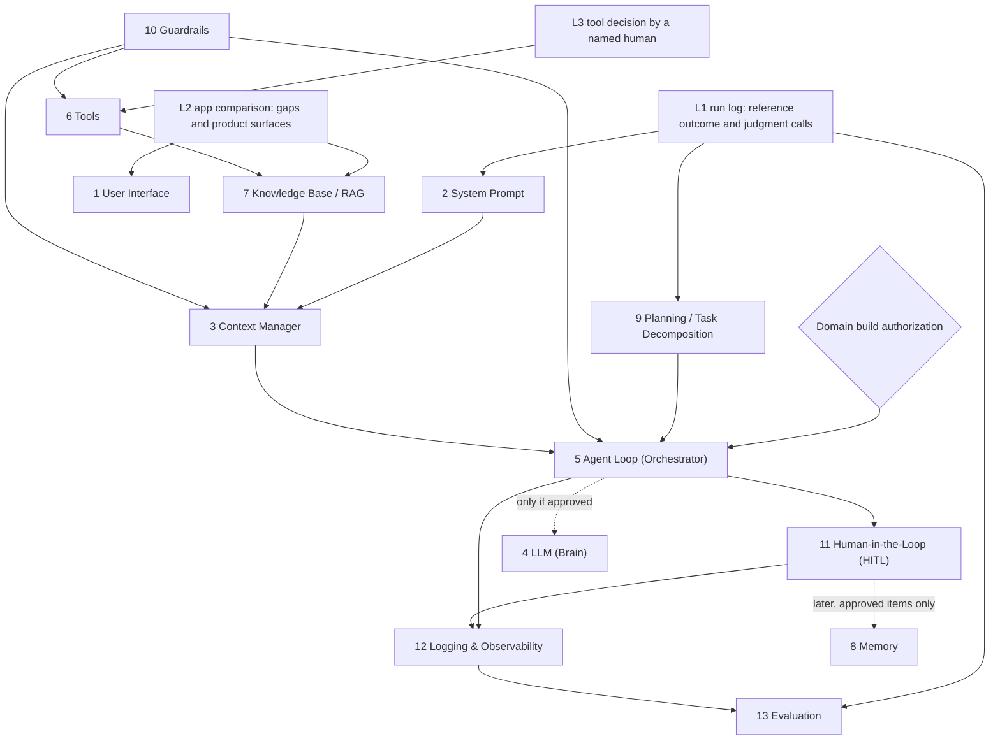

# Component dependencies and roadmap

The order in which the 13 components would be introduced, what each depends on, and the gates set
by the capability's four-step ladder (L1 to L4). **This is a proposed sequence, not an approved
plan.** No tool or integration is assumed to be available.

## 1. The ladder this roadmap follows

The platform defines four steps for this capability, in order. Each story says a later step opened
before its predecessor is complete is "the thing this ladder exists to prevent."

| Step | Story | What it is | Platform state |
|---|---|---|---|
| L1 | `marketing.CAP.social_signal_discovery.L1-BY-HAND` | Do the work by hand, once, end to end, and write a run log | not_started |
| L2 | `marketing.CAP.social_signal_discovery.L2-IN-THE-APP` | Produce the same outcome using only the product, no agent | not_started |
| L3 | `marketing.CAP.social_signal_discovery.L3-TOOL-REQUEST` | File a tool request; a named human decides | not_started |
| L4 | `marketing.CAP.social_signal_discovery.L4-AGENT-WATCHED` | The agent does it at R0, a named human approving every run | not_started |

Platform states read from `.colaberry/progress.json` on November 20, 2026. Each story file says
"Blocked by: nothing", but each step depends on the one before; see
[04-l1-l2-validation-plan.md](04-l1-l2-validation-plan.md).

## 2. Component dependencies

Read it from the top: L1 and L2 supply the facts, L3 supplies the tools, and build authorization
is required before the orchestrator exists. Dotted lines are optional or later.

## 3. Phases

| Phase | Ladder gate | Components worked on | How | Status |
|---|---|---|---|---|
| 0 | **L1** (now authorized: manual, read-only) | The human performs what UI, Knowledge Base, Logging and Evaluation will later do. Judgment calls are found for the System Prompt, Planning and Guardrails | By hand, in a browser, on the 8 approved platforms; results kept in private local files | Not started; keyword list and buyer criteria PENDING Sohail |
| 1 | **L2** | UI (platform Outreach pages), Knowledge Base (stored signals as the product shows them) | Same outcome using only the product; every gap named | Not started; depends on L1 |
| 2 | **L3** | Tools; Guardrails written as the tool's "must never touch" scope; HITL (who approves a run) | A change request citing the L1 run log and L2 result; a named human decides | Not started; depends on L1 and L2 |
| Gate | **Domain build authorization** | None may be built before this | Ali or Sohail authorizes building | Not granted |
| 3 | Before **L4** | First version: Context Manager, Agent Loop (R2 read-only path), Knowledge Base retrieval, Guardrails, HITL per-run approval, Logging run trace, Evaluation harness; System Prompt as configuration | Design and tests first; read-only by structure | Proposed only |
| 4 | **L4** | Runs at R0 with a named human approving every run | Evidence window with named approvers | Proposed only; criteria conflict below |
| 5 | After L4 | LLM (if approved), Memory (approved items only), richer planning | Each needs its own decision | Proposed only |

## 4. First version versus later

| First version (after build authorization) | Later, each needing its own decision |
|---|---|
| 1 User Interface (a read-only question panel) | 4 LLM (Brain): only if Sohail agrees how a model call fits "zero outbound network calls" |
| 3 Context Manager | 8 Memory: only items a human approves |
| 5 Agent Loop (Orchestrator), the R2 read-only path | 9 Planning beyond the fixed workflow |
| 6 Tools: `read_marketing_database` only, if granted at L3 | Any write or scan tool (`sandbox_database_write`, `platform_public_api_read_allowlisted`): R4 and above |
| 7 Knowledge Base / RAG, deterministic retrieval | |
| 10 Guardrails | |
| 11 Human-in-the-Loop (HITL), per run | |
| 12 Logging & Observability, run trace | |
| 13 Evaluation | |
| 2 System Prompt, as configuration rules (full prompt only with an LLM) | |

## 5. What each gate must settle

**Validated through L1 and L2** (detail in [04-l1-l2-validation-plan.md](04-l1-l2-validation-plan.md)):

- What a buyer signal really is, and which judgment calls a human makes finding one.
- Which steps are mechanical and which need judgment (the L1 story asks for this split).
- Whether the product can produce the outcome without an agent, and where it cannot.
- How stored signals look in the product, including rows that are not buyer conversations.

**Requires a tool request at L3:**

- Read access to stored signals (`read_marketing_database`), scoped to `openclaw_signals`.
- Whether run logging (`agent_activity_log_write`) is allowed.
- For each tool: scope, what it must never touch, and who approves a run (L3 criterion 1).

**Requires build authorization before L4:**

- Building any component in phase 3. No executable agent code exists, and none is authorized.
- Decisions recorded in the audit: whether R2 may use a hosted model, and whether R2 runs may write
  bookkeeping rows.

## 6. The L4 requirements conflict (needs Sohail or platform clarification)

The L4 story's criteria pull in two directions:

- Criterion 1 is the R2 answer behavior: "Every answer cites a stored openclaw_signals row id; zero
  outbound network calls in the trace." Its stated behavior: "Answers 'where are buyers talking
  about this' from already-stored signals without scanning."
- Criterion 2 asks for reproduction of L1: "The agent produced the same outcome as the step 1 run
  log, on the same inputs, including the exceptions recorded there."

L1's outcome is **discovering** new signals on public platforms, which is scanning. An agent that
answers from stored signals without scanning cannot produce that outcome on those inputs. Until
Sohail or the platform says which reading applies (for example: L1 includes a by-hand "answer the
question from what was found" step, or L4 judges only the answering part), L4 cannot be judged.
This roadmap does not resolve it.
